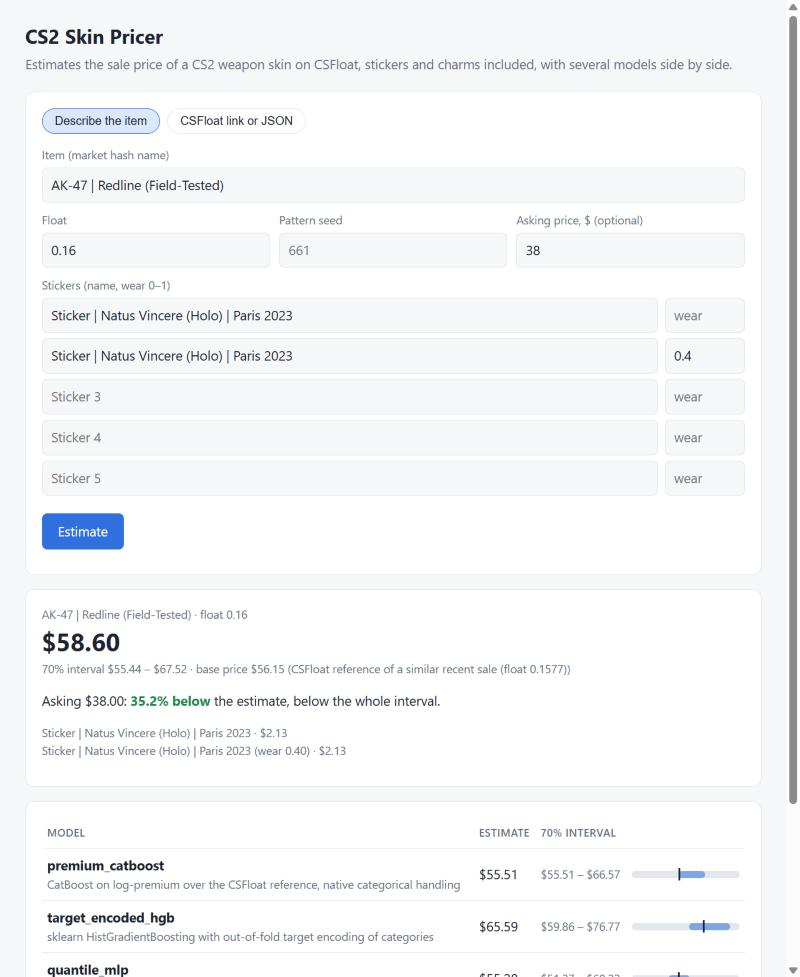

# CS2 Skin Pricing: оценка цен скинов CS2

Модели, которые предсказывают, за сколько продастся оружейный скин из Counter-Strike 2,
в том числе с наклейками (такие предметы называют **крафтами**). Обучены на 820 тысячах
реальных продаж с маркетплейса [CSFloat](https://csfloat.com). Вторая часть проекта
отвечает на вопрос, можно ли с помощью точной модели заработать на перепродаже.

**Главные результаты.** Модели проверялись на 164 тысячах продаж за 2–10 августа 2026 года,
которых они не видели при обучении:

- Ансамбль из трёх моделей в типичном случае ошибается на **4,6%** от цены, в среднем
  на **$1,27** за лот. Собственная оценка CSFloat ошибается на 6,0% и $2,37. Больше всего
  разница видна на дорогих крафтах: когда наклейки на оружии стоят $100–500, оценка
  CSFloat промахивается на 39%, модели на 13–16%.
- Основная модель уменьшилась с **8 ГБ до 6 МБ** без потери точности
  ([эксперимент 03](experiments/03_model_compression/README.md)).
- Проверка на истории торгов показала, что модель действительно находит недооценённые
  лоты. Но самые выгодные из них за считанные минуты выкупают боты, а человеку остаётся
  около +2–4% за двухнедельный цикл ([эксперимент 07](experiments/07_trading_backtest/README.md)).



## Коротко о предметной области

- **Скин** — раскраска оружия в CS2. Скины покупают и продают за реальные деньги.
- **Float (износ)** — число от 0 до 1: чем оно меньше, тем новее выглядит скин. Один и тот
  же скин с разным float может стоить по-разному.
- **Паттерн** (seed) — номер, от которого зависит расположение рисунка. У некоторых скинов
  редкие паттерны (например, «blue gem» у Case Hardened) стоят в десятки раз дороже обычных.
- **Наклейки и брелоки.** На оружие можно наклеить до пяти наклеек и повесить брелок.
  Редкие наклейки сами по себе стоят сотни долларов.
- **CSFloat** — маркетплейс, данные которого используются в проекте. Для каждого предмета
  он показывает свою оценку цены (`reference.predicted_price`).

## Идея

Для обычного скина без наклеек оценка CSFloat уже очень точна: типичная продажа проходит
ровно по ней. Но наклейки и брелоки эта оценка не учитывает, а именно в них деньги:
крафты составляют 18% продаж и 52% оборота. Если наклейки на оружии стоят больше $500,
оно продаётся в среднем в 4,5 раза дороже оценки.

Поэтому модели не угадывают цену с нуля. Они предсказывают **наценку**, то есть
насколько цена отличается от оценки CSFloat:

```
цель модели = log1p(цена) − log1p(оценка CSFloat)
прогноз     = expm1(ответ модели + log1p(оценка CSFloat))
```

У 80% лотов наценка почти нулевая. Модели не нужно заново учить, сколько стоит каждый
скин: всё её внимание уходит на то, что отличает лот от обычного, то есть на наклейки,
брелоки, редкие паттерны и крайние значения float. Если сравнивать с прямым
предсказанием цены по тем же данным, ошибка в долларах снижается на 28%
([эксперимент 01](experiments/01_premium_target/README.md)).

## Как измеряется точность

- **Медианная ошибка** (MdAPE, median absolute percentage error) показывает, на сколько
  процентов прогноз отличается от реальной цены в типичном случае: у половины продаж
  ошибка меньше, у половины больше. Проценты удобны, потому что цены лежат в диапазоне
  от нескольких центов до тысяч долларов.
- **Средняя ошибка в долларах** (MAE) — на сколько долларов модель промахивается в среднем.
  Эта метрика особенно чувствительна к дорогим лотам.
- **Ошибка p90**: у 9 прогнозов из 10 ошибка не больше этого значения.
- **70%-вилка.** Кроме самой оценки, модель выдаёт диапазон цен. Если вилка
  откалибрована правильно, реальная цена попадает в неё в 70% случаев.
- **п.п.** (процентные пункты) — разница между двумя процентами: 4,96% → 4,65% это
  улучшение на 0,31 п.п.

Проверка устроена честно: данные разделены по времени. Модели учатся на продажах до
29 июля 2026 года. Следующие 4 дня (валидация) нужны, чтобы решить, когда остановить
обучение и какой ширины делать вилку. Итоговая оценка считается на продажах
2–10 августа, которых модели не видели.

## Модели

Первые две строки — простые ориентиры без обучения (бейзлайны). Остальные модели должны
их обыграть.

| модель | как устроена | медианная ошибка | ошибка p90 | средняя ошибка | цена в 70%-вилке | размер |
|---|---|---|---|---|---|---|
| `csfloat_reference` | оценка CSFloat с поправкой на систематический сдвиг | 5,99% | 40,5% | $2,37 | 70,1% | — |
| `recent_median` | медиана последних 20 продаж такого же предмета | 7,91% | 44,4% | $2,92 | 69,6% | — |
| `premium_catboost` | градиентный бустинг CatBoost: сам превращает категории (названия скинов и наклеек) в числа; одна модель выдаёт и оценку, и вилку | 4,96% | 26,8% | $1,38 | 65,9% | 6 МБ |
| `target_encoded_hgb` | градиентный бустинг из scikit-learn, категории заранее кодируются средней наценкой (target encoding) | 4,65% | 26,1% | $1,37 | 71,1% | 8 МБ |
| `quantile_mlp` | нейросеть на PyTorch: эмбеддинги для категорий, остаточные блоки, выход сразу для трёх квантилей, которые не могут «перепутаться» местами | 4,67% | 25,2% | $1,42 | 69,0% | 12 МБ |
| **ансамбль** | среднее геометрическое трёх обученных моделей | **4,60%** | **24,7%** | **$1,27** | 71,7% | |

**Градиентный бустинг** — сотни небольших деревьев решений, где каждое следующее исправляет
ошибки предыдущих. Это стандартный и очень сильный метод для табличных данных. Все модели
получают одинаковые признаки и одинаковое разбиение по времени, а вилку калибруют на днях
валидации. Подробности и разбивка по сегментам — в
[эксперименте 02](experiments/02_model_comparison/README.md).

## Исследования

| № | вопрос | ответ |
|---|---|---|
| [01](experiments/01_premium_target/README.md) | Что предсказывать: саму цену или наценку к оценке CSFloat? | Наценку: средняя ошибка $1,38 против $1,93 при тех же данных. Без оценки CSFloat медианная ошибка 14,7%, а дорогие крафты недооцениваются |
| [02](experiments/02_model_comparison/README.md) | Какая модель лучше? | Три модели укладываются в 0,3 п.п. Простой бустинг из scikit-learn точнее всех и обучается быстрее всех, нейросеть ему не уступает, а ансамбль лучше каждой модели по отдельности |
| [03](experiments/03_model_compression/README.md) | Можно ли уменьшить модель весом 8 ГБ? | Да, до 6 МБ без потери точности. Размер раздувал один признак, почти уникальный для каждой продажи: «скин + номер паттерна» |
| [04](experiments/04_feature_ablation/README.md) | Какие данные важны для модели? | Оценка CSFloat и наклейки. Данные о редких паттернах помогают «своим» скинам. Число наблюдающих за лотом и время продажи не помогают. Признаки истории рынка дают модели scikit-learn всё её преимущество над CatBoost. Эффекты меньше 0,1 п.п. считаются шумом |
| [05](experiments/05_sticker_reference_leakage/README.md) | Не завышают ли точность цены наклеек, записанные уже после продажи? | Нет. У 93% тестовых крафтов цены наклеек записаны не позже чем через 3 дня после продажи, а если прятать поздние цены, становится только хуже |
| [06](experiments/06_error_budget/README.md) | Где модель ошибается сильнее всего? | 4% лотов дороже $100 дают 59% ошибки в долларах. Для предметов дороже $20 модель так же точна, как «знание сегодняшних цен таких же предметов». Незнакомые сочетания наклеек она оценивает так же хорошо, как знакомые |
| [07](experiments/07_trading_backtest/README.md) | Можно ли заработать с помощью модели? | Модель обыгрывает случайные покупки на 8–22 п.п., но прибыль сосредоточена в лотах, которые боты выкупают за минуты. Оценка CSFloat как сигнал к покупке не хуже модели |
| [08](experiments/08_refit_on_validation/README.md) | Стоит ли дообучить финальную модель на днях валидации? | Бустингам это даёт −0,05 п.п., нейросети ничего |
| [09](experiments/09_catboost_tuning/README.md) | Почему CatBoost отстаёт? | Не из-за настроек: три изменения сдвигают результат меньше чем на 0,05 п.п. Разницу объясняют признаки истории рынка: они помогают модели scikit-learn и не помогают CatBoost (эксперимент 04) |

Для каждого исследования есть README (вопрос, метод, результат, вывод), скрипт `run.py`,
который его воспроизводит, и `results.md` с полными таблицами. Журнал исследований с
выводами исходного исследования и списком открытых вопросов лежит в
[experiments/README.md](experiments/README.md). Исходный отчёт —
[reports/](reports/README.md), ноутбуки с графиками — [notebooks/](notebooks/).

## Инженерная часть

- **Обучение и предсказание используют один и тот же код.** Лот, введённый вручную в
  веб-форме, JSON лота с CSFloat и строка из обучающей базы проходят через одни и те же
  функции. Тест `tests/test_inference.py` проверяет, что для настоящего лота получаются в
  точности те же признаки, что и при обучении.
- **История рынка без подглядывания в будущее.** Средние наценки скина, каждой наклейки и
  пары «скин + паттерн» считаются только по продажам, которые прошли *строго раньше*.
  При предсказании те же числа берутся из сохранённого снимка рынка, а тест
  `tests/test_history_parity.py` проверяет, что они совпадают. Этот тест поймал настоящую
  ошибку: в одном слоте может стоять несколько одинаковых наклеек (в CS2 это разрешено),
  и при обработке данных они терялись.
- **Сервису не нужна база данных.** SQLite на 4,5 ГБ заменён снимком рынка на 11 МБ.
- **Разбиение по времени.** Обучение идёт до 29 июля, затем валидация (остановка обучения,
  калибровка вилки), затем тест 2–10 августа. На тесте каждая модель оценивается один раз.
- **Эксперименты оформлены как код.** Каждое число в этом README получено скриптом
  `run.py`. Результаты кэшируются по вариантам и хранятся в репозитории.

```
src/skinprice/
  data/          SQLite -> parquet, разбор JSON CSFloat, сборщик данных, публичный сэмпл
  features/      признаки лота + история рынка без подглядывания + именованные группы признаков
  models/        общий интерфейс: 2 бейзлайна, CatBoost, бустинг scikit-learn, нейросеть PyTorch
  evaluation/    метрики и разбивка по сегментам
  inference/     каталог предметов, признаки из снимка рынка, Predictor (ансамбль)
  server/        приложение FastAPI с одной HTML-страницей
  research/      запуск экспериментов, бэктест торговли, стиль графиков
experiments/     01–09: вопрос -> run.py -> результаты -> вывод
notebooks/       знакомство с данными, сравнение моделей, анализ ошибок, бэктест торговли
data/sample/     все продажи 5% скинов (37 тыс. продаж) для тестов и CI
tests/           25 тестов: совпадение обучения и сервиса, модели, API, логика бэктеста
```

## Быстрый старт

Нужен Python 3.11 или новее.

```bash
pip install -e ".[nn,server,dev]"
pytest                      # тесты на встроенном сэмпле, около 3 минут
```

Обучить модели на встроенном сэмпле и запустить сервис (несколько минут на ноутбуке):

```bash
skinprice features build --dataset data/sample
skinprice train target_encoded_hgb
skinprice train premium_catboost --set iterations=500
skinprice snapshot build --dataset data/sample
skinprice predict --name "M4A1-S | Golden Coil (Field-Tested)" --float 0.18 --price 58 \
    --sticker "Sticker | Natus Vincere (Holo) | Paris 2023" \
    --sticker "Sticker | Natus Vincere (Holo) | Paris 2023@0.3"
skinprice serve             # http://127.0.0.1:8000
```

Полный цикл (нужна своя собранная база продаж):

```bash
skinprice collect --items items.txt        # история продаж CSFloat -> SQLite (нужен CSFLOAT_API_KEY)
skinprice data build                       # SQLite -> parquet
skinprice features build                   # около минуты на 820 тыс. продаж
skinprice train target_encoded_hgb         # около 5 минут
skinprice train premium_catboost           # около 20 минут на 16 потоках
skinprice train quantile_mlp               # около 45 минут на CPU
skinprice evaluate                         # метрики последних моделей на тесте
skinprice snapshot build
```

Тяжёлые файлы (датасет, признаки, модели, снимок рынка) хранятся вне git, в рабочей папке.
Её путь задаётся переменной `SKINPRICE_WORKSPACE` в файле `.env` (пример в `.env.example`).

### API

`POST /api/predict` принимает один из трёх вариантов:

```json
{"url": "https://csfloat.com/item/<listing id>"}
{"listing": { "...": "JSON лота с CSFloat" }}
{"manual": {"name": "AWP | Asiimov (Field-Tested)", "float_value": 0.26, "price_usd": 120,
            "stickers": [{"name": "Sticker | Natus Vincere (Holo) | Paris 2023", "wear": 0.1}]}}
```

В ответе — оценка и вилка каждой модели, оценка ансамбля, а если указана цена, то насколько
она выше или ниже оценки. Для лота, введённого вручную, оценка CSFloat берётся из самой
похожей недавней продажи того же предмета (с ближайшим float).

### Как проверить свою гипотезу

```python
# experiments/10_my_idea/run.py
from skinprice.features.spec import DEFAULT_GROUPS, FeatureSpec
from skinprice.research import Experiment

exp = Experiment("10_my_idea")
features = exp.features()
exp.reuse("baseline", "02_model_comparison", "target_encoded_hgb")
exp.variant("with_my_feature", "target_encoded_hgb", features,
            spec=FeatureSpec(DEFAULT_GROUPS + ("my_group",)))
exp.report()
```

Новые признаки добавляются в `features/static.py`, если их можно посчитать по одному
лоту, или в `features/history.py`, если нужны прошлые продажи. Во втором случае нужно
дополнить и `MarketSnapshot`; тест совпадения подскажет, если сервис считает иначе.
Затем признак регистрируется в именованной группе в `features/spec.py`.

## Данные

Завершённые продажи оружейных скинов, собранные через API истории продаж CSFloat, с 2023
года по 10 августа 2026 (большая часть пришлась на июль–август 2026): 822 тысячи продаж,
428 тысяч наклеек, 28 тысяч брелоков. В `data/sample/` лежат все продажи
детерминированно выбранных 5% скинов (37 тысяч продаж). На них код, тесты и ноутбуки
работают без полной базы.
